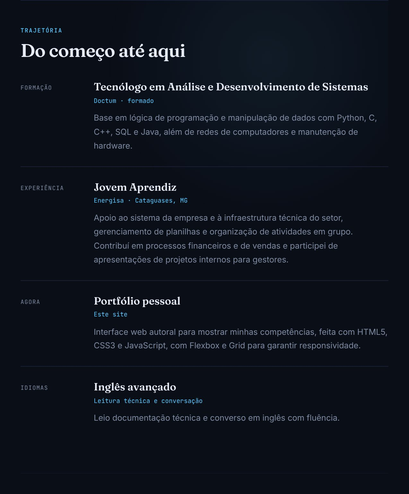

<div align="center">

# Yuri Teixeira · Portfólio Pessoal

**Desenvolvedor de Software** · formado em Análise e Desenvolvimento de Sistemas

[**Ver o site ao vivo →**](https://yurisilvaaa.github.io/)


</div>

<br>

<p align="center">
  
</p>

## Sobre o projeto

Um site pessoal no formato de currículo: direto ao ponto, com quem eu sou, por onde passei e o que já construí. Feito com **HTML5, CSS3 e JavaScript puro**, sem frameworks nem bibliotecas.

## O que tem no site

| Seção | Conteúdo |
| --- | --- |
| **Sobre** | Apresentação rápida e botão para baixar o currículo em PDF |
| **Trajetória** | Formação, experiência na Energisa, portfólio e idiomas |
| **Cursos** | Certificados do IFRS em HTML5, CSS3 e JavaScript, com visualização na própria página |
| **Projetos** | Projetos publicados |
| **Habilidades** | O que eu já uso e o que estou estudando agora |
| **Contato** | Formulário que envia a mensagem direto para o meu e-mail, além de GitHub e LinkedIn |

## Detalhes técnicos

- **Layout responsivo** com CSS Grid e Flexbox: menu lateral no computador e barra fixa no celular
- **Menu que acompanha a rolagem**, destacando a seção que está na tela (`IntersectionObserver`)
- **Barra de progresso de leitura** no topo da página
- **Certificados em tela cheia** que fecham com `Esc` ou clique fora da imagem
- **Formulário de contato** com validação dos campos e proteção contra spam, enviado pelo [FormSubmit](https://formsubmit.co)
- **Versão para impressão**: ao imprimir, a página vira um currículo limpo em fundo branco
- **Acessibilidade**: foco visível no teclado, atalho para pular ao conteúdo e respeito à opção de reduzir animações

## Como rodar localmente

```bash
git clone https://github.com/YuriSilvaaa/YuriSilvaaa.github.io.git
cd YuriSilvaaa.github.io
```

Depois abra o `index.html` no navegador, ou use a extensão **Live Server** do VS Code para ver as mudanças em tempo real.

## Estrutura

```
├── index.html          # conteúdo da página
├── style.css           # tema escuro, layout e responsividade
├── script.js           # interações (menu, certificados, formulário)
├── curriculo.pdf       # currículo para download
├── foto.jpg
├── certificados/       # certificados dos cursos (CPF ocultado)
└── docs/               # imagem deste README
```

## Contato

- **E-mail:** yurisilvakta84@gmail.com
- **LinkedIn:** [linkedin.com/in/yuri-teixeiradev](https://www.linkedin.com/in/yuri-teixeiradev)
